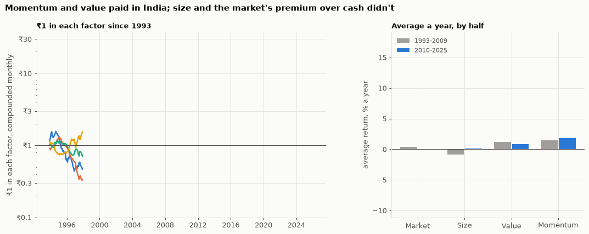
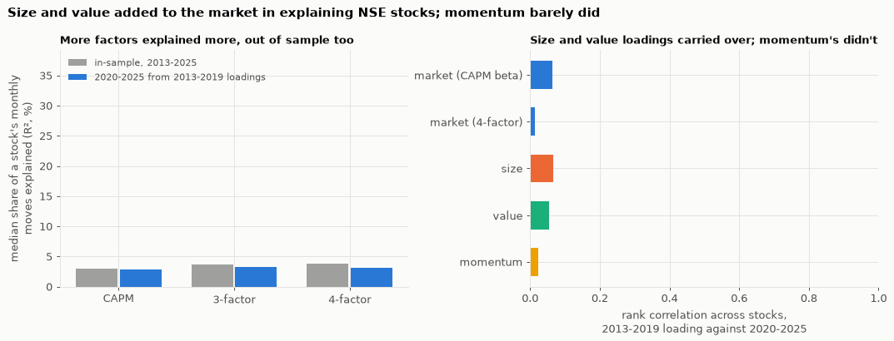
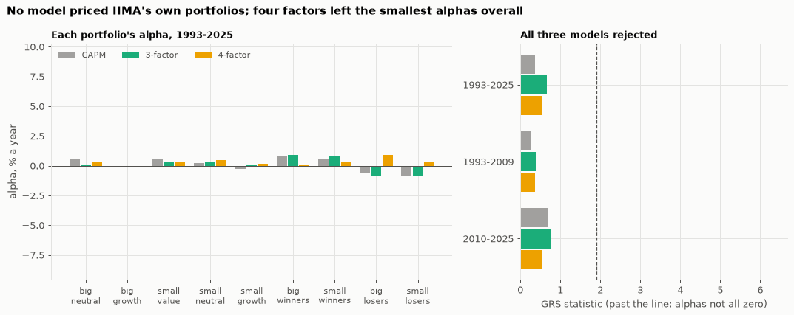

# Fama-French Factors

[](https://github.com/Dhirajdas18/fama-french-factors/actions/workflows/ci.yml)
[](https://dhirajdas18.github.io/fama-french-factors/)

The market, size, value and momentum factors in Indian equities from 1993 to 2025, using IIM
Ahmedabad's survivorship-bias adjusted factor library: what each earned, how well they explain
stocks, portfolios and mutual funds, and how they crash. Fund prices are AMFI net asset values;
stock prices come from a local NSE archive, and only derived results are committed.

**Live factor lab: [dhirajdas18.github.io/fama-french-factors](https://dhirajdas18.github.io/fama-french-factors/)**,
pick any years to see what each factor earned, and split any Indian mutual fund's return into its
market, size, value and momentum exposures and what is left over, computed in your browser.

## Features

- [x] What market, size, value and momentum earned in India, 1993–2025, by half, with their worst falls
- [x] Momentum rebuilt from the NSE archive and checked against the library's factor
- [x] CAPM against three and four factors on single stocks: how much each explains, and stable loadings
- [x] Do the factors price the size-value portfolios? The GRS test for CAPM, three and four factors
- [ ] Mutual funds: is their alpha just size, value and momentum? Out of sample
- [ ] Factor crashes: momentum and value drawdowns, and a risk-scaling rule chosen on early years
- [ ] Verdict: which factors to use for risk and attribution, and whether to tilt towards any

## Findings

### 1. Momentum and value paid most in India; small companies didn't beat big ones

<a href="docs/img/factors.png"><picture><source media="(prefers-reduced-motion: reduce)" srcset="docs/img/factors.png"></picture></a>

IIM Ahmedabad's monthly factors (release 2025-12, November 1993 to December 2025, 385 months;
November 1994 has no long-short returns and is left out), survivorship-bias adjusted. Market is
the market's return minus the risk-free rate (the library's MF column, which matches its own
published market premium of 4.93% a year since 1994); size (small minus big), value (cheap minus
expensive on book-to-market) and momentum (winners minus losers on past returns) are long-short
portfolios of listed companies, micro-caps and penny stocks excluded. Each factor's average a year
is 12 times its monthly mean, with a Newey-West t (3 lags); compounded growth uses calendar years;
the halves are 1993–2009 and 2010–2025. Nothing is fitted. The market's own return is checked
against NIFTY from the local archive where both exist.

- **Momentum paid most.** Winners beat losers by 13.3% a year on average (t 2.84), 10.9% a year
  compounded; 14.8% (t 3.70) in 2010–2025. Over five-year windows it compounded between −2.3% and
  +29.7% a year and was below zero in 1% of them.
- **Value paid in both halves.** Cheap beat expensive by 8.5% a year (t 2.34): 10.1% in 1993–2009
  and 6.9% in 2010–2025 (t 1.7 each). Its worst fall was −59%, from October 1994 to February 2000.
- **Size didn't pay.** Small minus big averaged −2.9% a year (t −0.88): −6.8% in 1993–2009 and
  +1.0% since, and it fell 86% from January 1995 to March 2009.
- **The market beat cash, with deep falls.** The market premium averaged 8.6% a year (t 1.78) and
  compounded 5.7%; the market itself compounded 13.0% a year against 6.9% for cash. It fell 75%
  from August 1994 to September 2001. From March 2013 it compounded 15.9% a year against 12.6% for
  NIFTY's price index, which leaves out dividends (monthly correlation 0.92).
- **Momentum and value offset each other.** Their monthly correlation was −0.37; market and size
  +0.25, market and value +0.22.

### 2. Momentum rebuilt from about 460 liquid NSE stocks tracked IIMA's factor

<a href="docs/img/momentum.png"><picture><source media="(prefers-reduced-motion: reduce)" srcset="docs/img/momentum.png"></picture></a>

IIMA's momentum rule (working paper 2013-09-05, section 3.2): at each month-end, momentum is the
return from 12 months back to one month back; winners are the top 30%, losers the bottom 30%; big
companies are the top 10% by market value; the factor is the average of big winners minus big
losers and small winners minus small losers, value-weighted, held for the next month. The NSE
archive has split-adjusted prices for every stock that was among its most-traded from 2013,
including 69 that later stopped trading, but no shares outstanding, so the rebuild uses each
stock's median daily turnover over the past year for size and weights stocks equally; a stock
that stops trading keeps its last price. It is compared with IIMA's factor over the 143 months
both cover, February 2014 to December 2025, changing one choice at a time. Nothing is fitted.

- **It tracked IIMA's factor.** The IIMA-like rebuild made 11.9% a year (t 2.01) against IIMA's
  12.9% (t 2.92), with a monthly correlation of 0.76; regressed on IIMA's, its loading was 1.00 and
  its intercept −1.0% a year. Tracking error was 12.9% a year.
- **It was rougher.** Its worst fall was −43% against IIMA's −26% over the same months.
- **The details moved the average by several points.** Without the size split it made 16.1% a year;
  with turnover weights, 8.7%; without skipping the latest month, 11.3%; with today's survivors only,
  9.9%. Every variant kept a correlation of 0.73–0.76 with IIMA's.
- **Both halves agreed.** The correlation was 0.77 in 2014–2019 (17.1% a year against IIMA's 16.5%)
  and 0.74 in 2020–2025 (6.7% against 9.3%).
- **Winners change slowly.** On average 17% of the winners list was replaced each month.

### 3. Size and value helped explain NSE stocks; momentum didn't

<a href="docs/img/stocks.png"><picture><source media="(prefers-reduced-motion: reduce)" srcset="docs/img/stocks.png"></picture></a>

Each stock's monthly return in the NSE archive (split-adjusted month-end prices, so dividends are
left out) minus IIMA's risk-free rate is regressed on the market alone (CAPM), on market, size and
value (three factors), and on those plus momentum (four factors), with Newey-West t (3 lags).
In-sample: the 494 stocks with at least 60 months between February 2013 and December 2025. Out of
sample: for the 389 stocks with at least 48 months in each half, loadings fitted on 2013–2019
predict each 2020–2025 month from that month's factor returns, with no alpha; the score is the
share of the stock's 2020–2025 variation that prediction explains. The archive holds stocks that
were among its most-traded at some point from 2013 (140 of its 556 stocks were first priced after
June 2013), so in-sample alphas are not evidence of skill.

- **The market alone explained about a quarter.** CAPM's median R² was 24.5% in-sample; three
  factors 30.3%, four 31.4%.
- **Three factors kept their edge out of sample.** Loadings from 2013–2019 explained a median 23.5%
  of 2020–2025 with CAPM, 26.5% with three factors and 25.2% with four; three factors beat CAPM for
  71% of stocks, and four beat three for only 42%.
- **Most stocks leaned small, and many cheap.** Measured against IIMA's factors, where big means the
  top 10% of all listed companies, the median size loading was +0.40 (significantly positive for
  44% of stocks) and value +0.19 (28%); momentum −0.16, significantly negative for 14%.
- **Size and value loadings carried over; momentum's didn't.** Ranked across stocks, 2013–2019
  loadings matched 2020–2025 with a correlation of 0.55 for size, 0.44 for value and 0.18 for
  momentum. CAPM beta kept 0.52, but the market loading inside the four-factor model only 0.11.

### 4. No model priced IIMA's own portfolios; four factors left the smallest alphas overall

<a href="docs/img/grs.png"><picture><source media="(prefers-reduced-motion: reduce)" srcset="docs/img/grs.png"></picture></a>

The test assets are IIMA's six size-value portfolios less big value (absent in 154 months, when it
held under five stocks) and its four size-momentum portfolios, in excess of the risk-free rate,
over the 377 months with all nine, November 1993 to December 2025. Each is regressed on CAPM, three
and four factors; the Gibbons-Ross-Shanken (GRS) test asks whether all nine alphas are zero at once,
assuming normal, independent errors. Big value is tested alone on its own 232 months. The factors
are built from these same portfolios: IIMA's published size, value and momentum factors match the
corresponding portfolio differences with monthly correlations of 0.995, 0.997 and 0.983 (they are
compounded from daily returns, so not exactly), so the test asks whether the factors' averages
line up with the portfolios' averages, not whether unrelated assets are priced.

- **Every model was rejected.** GRS was 3.07 for CAPM, 5.44 for three factors and 4.35 for four,
  against a 5% critical value of 1.91 (p 0.0015 and below 0.0001).
- **Four factors left the smallest alphas.** The average alpha, ignoring sign, was 4.0% a year
  for CAPM, 3.7% for three factors and 2.8% for four.
- **Three factors couldn't price momentum.** Their alphas were +7.3% and +6.4% a year for big and
  small winners and −6.7% and −6.5% for big and small losers; with momentum added they were +0.9%,
  +2.5%, +7.4% and +2.4%.
- **The rejection held in both halves.** In 1993–2009, GRS was 2.05 for CAPM (p 0.036), 3.32 and
  3.09; in 2010–2025, 5.63, 6.37 and 4.60.
- **Big value on its own was not rejected.** Its alpha was +9.4% a year under CAPM (t 1.55) and
  −3.3% under three factors (t −1.39).

## Quick start

```bash
uv sync
uv run python scripts/fetch_data.py   # IIMA factor library -> data/iima/
uv run ff report factors              # topics: factors, momentum, stocks, grs
uv run python scripts/build_site.py   # factor lab -> site/index.html
uv run pytest
```

The factor files are downloaded, not committed. The NIFTY comparison and later stock studies read a
local NSE bhavcopy archive (`FF_LAKE_DIR`, default `/path/to/lake`) and are skipped without
it.

## Design

- `src/ff/data.py`: finds the library's latest release, downloads its survivorship-bias adjusted
  factor and portfolio files with retries, and loads them as decimal returns by month-end.
- `src/ff/stats.py`: least squares with Newey-West t statistics, the return summary (average,
  volatility, compounded growth, t, worst month, worst 12 months, worst fall) and the
  Gibbons-Ross-Shanken test (F p-value from scipy).
- `src/ff/ff.js`: the lab's browser copy of the regression and summary, and monthly returns from
  mfapi.in net asset values, tested against Python through Node to 1e-8.
- `src/ff/site.py`: the factor lab, one static Plotly page that carries the monthly factors; fund
  prices are fetched live from mfapi.in.
- `src/ff/lake.py`: NIFTY's monthly return from the local NSE archive.
- `src/ff/momentum.py`: month-end prices and past-year turnover from the archive, and winners
  minus losers built the IIMA way (size by turnover, equal or turnover weights).
- `src/ff/exposures.py`: single stocks on CAPM, three and four factors: fits, out-of-sample
  explanation from earlier loadings, and loadings in each half.
- `src/ff/reports.py`: README findings, reproducible with `ff report <topic>`.
- Conventions: returns are monthly and simple, in decimals; averages are 12 × the monthly mean,
  volatility √12 × the monthly standard deviation, compounded growth over months ÷ 12 years; t
  statistics are Newey-West with 3 lags.
- Data: IIM Ahmedabad's Indian Fama-French-momentum data library (Agarwalla, Jacob and Varma,
  2013, Four factor model in Indian equities market, IIMA Working Paper 2013-09-05), the
  survivorship-bias adjusted series; AMFI net asset values through mfapi.in; NIFTY from a local NSE archive.
- Charts: one validated palette; README charts are animated GIFs with a static fallback for
  reduced-motion users.

Research only, not investment advice. MIT licence.
